# Failure gallery — baseline on test (conf ≥ 0.73, IoU 0.5)

Auto-generated from saved predictions. Colours: green = ground truth (mask tinted), red = prediction ≥ threshold, orange = prediction below threshold (≥ 0.05), magenta = the box this case is about.

Total box-level errors: **15** — FN/below_threshold: 11, FN/missed: 4
Image-level errors: **6**

| # | image | kind | error type | category | conf | IoU | box (px) | contrast | panel |
|---|---|---|---|---|---|---|---|---|---|
| 0 | test_bent_005 | FN | below_threshold | bent | 0.09 | 0.00 | 101×54 | 13.3 | 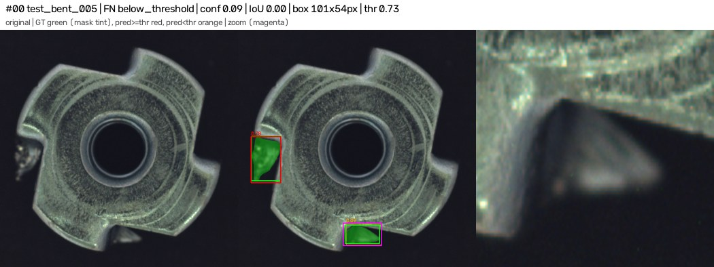 |
| 1 | test_bent_010 | FN | below_threshold | bent | 0.55 | 0.00 | 155×184 | 19.3 | 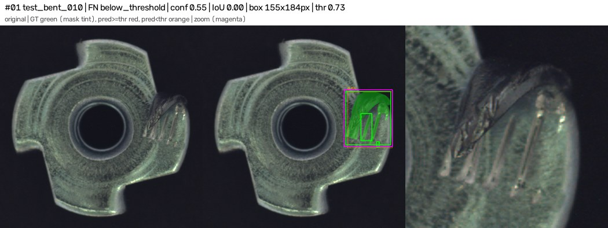 |
| 2 | test_bent_010 | FN | missed | bent | 0.55 | 0.00 | 38×94 | 1.5 | 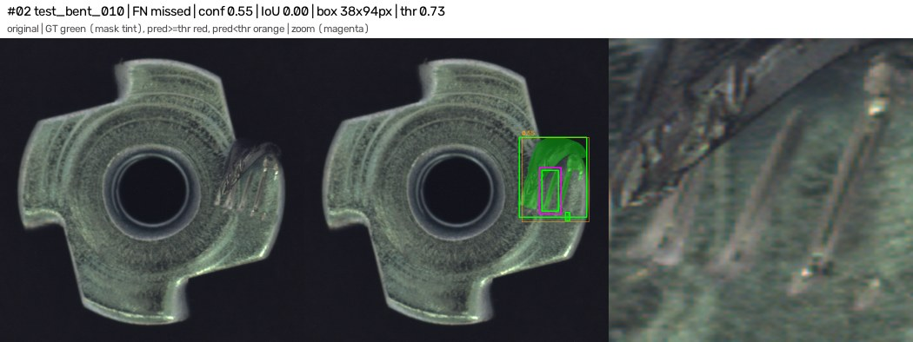 |
| 3 | test_bent_010 | FN | missed | bent | 0.55 | 0.00 | 11×19 | 12.1 | 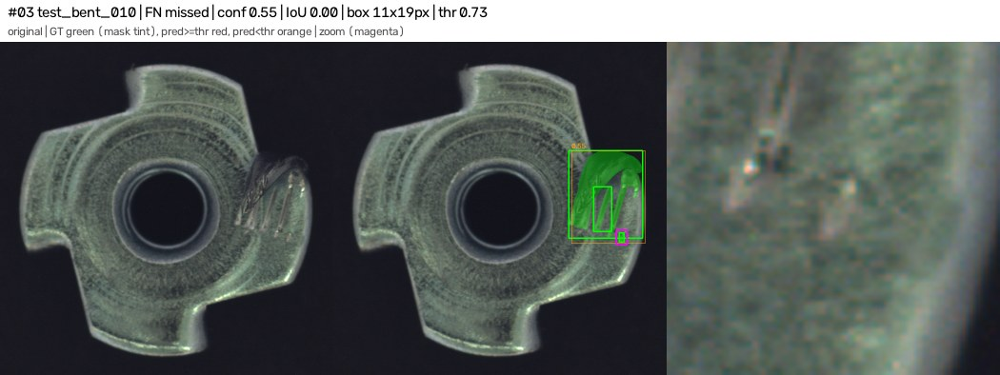 |
| 4 | test_bent_012 | FN | below_threshold | bent | 0.00 | 0.02 | 27×52 | 6.2 | 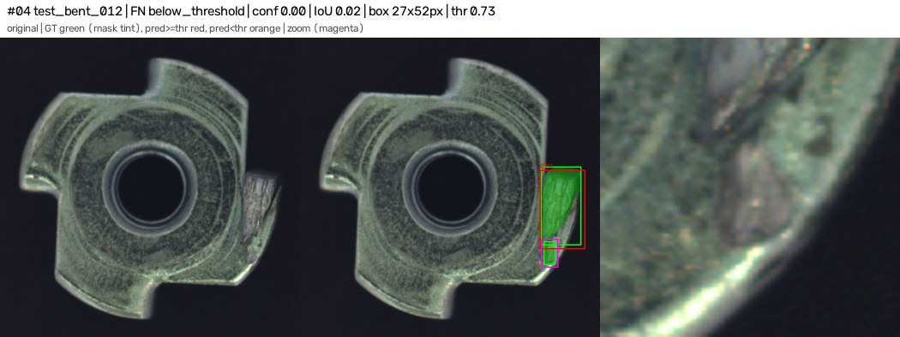 |
| 5 | test_bent_018 | FN | below_threshold | bent | 0.68 | 0.00 | 46×30 | 10.5 | 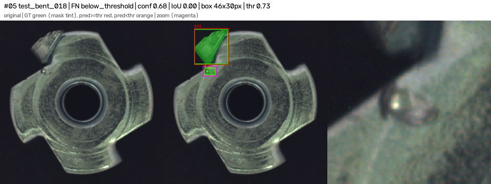 |
| 6 | test_bent_019 | FN | below_threshold | bent | 0.70 | 0.00 | 121×210 | 11.3 | 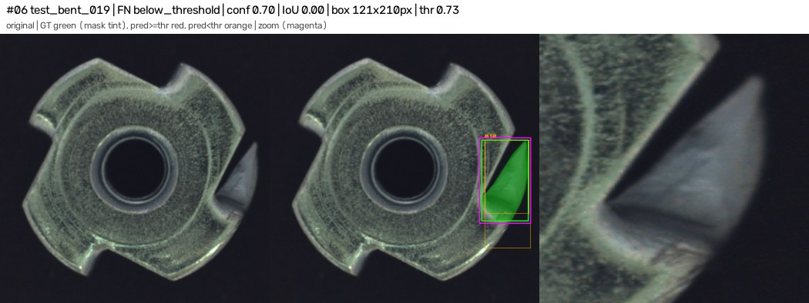 |
| 7 | test_color_004 | FN | below_threshold | color | 0.68 | 0.00 | 77×112 | 8.9 | 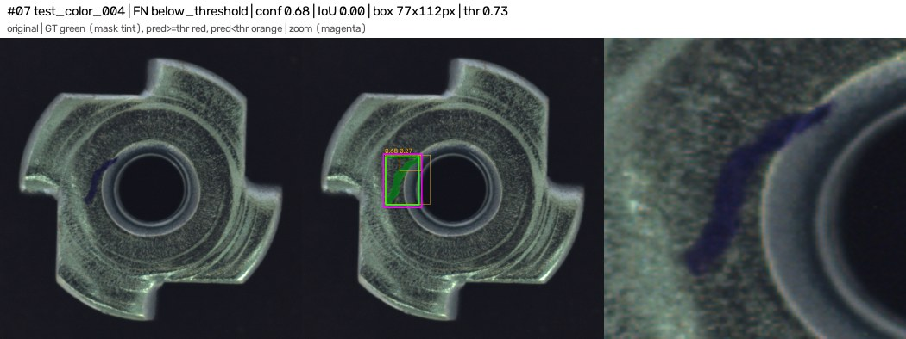 |
| 8 | test_color_007 | FN | missed | color | 0.91 | 0.01 | 10×12 | 3.7 | 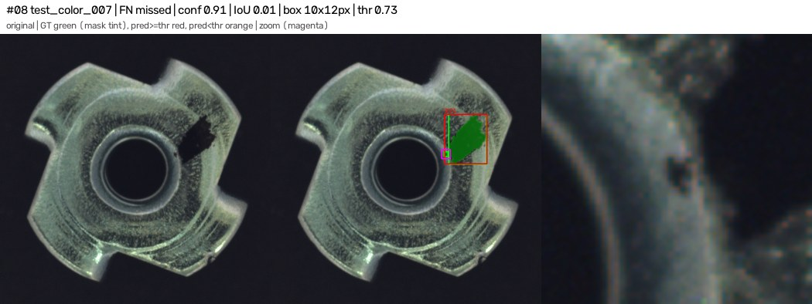 |
| 9 | test_color_011 | FN | below_threshold | color | 0.72 | 0.19 | 124×214 | 3.8 | 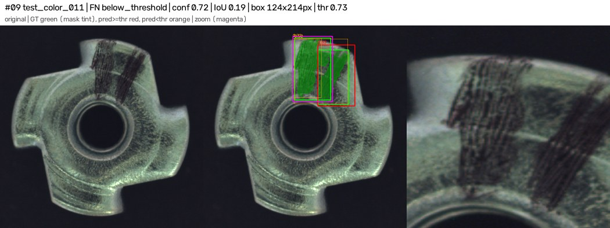 |
| 10 | test_scratch_000 | FN | below_threshold | scratch | 0.33 | 0.00 | 171×140 | 10.0 | 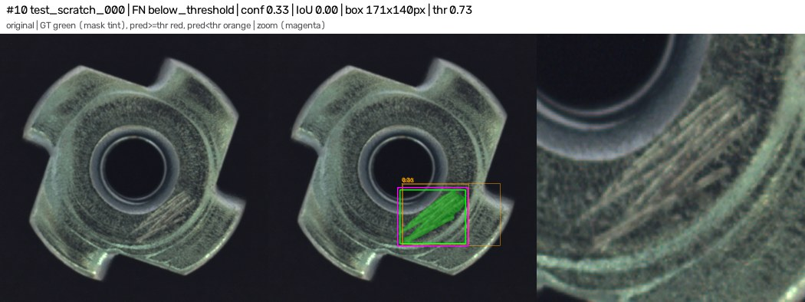 |
| 11 | test_scratch_012 | FN | below_threshold | scratch | 0.40 | 0.00 | 316×504 | 12.0 | 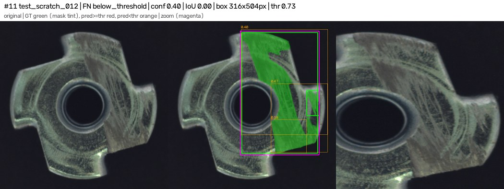 |
| 12 | test_scratch_012 | FN | missed | scratch | 0.47 | 0.00 | 51×105 | 5.0 | 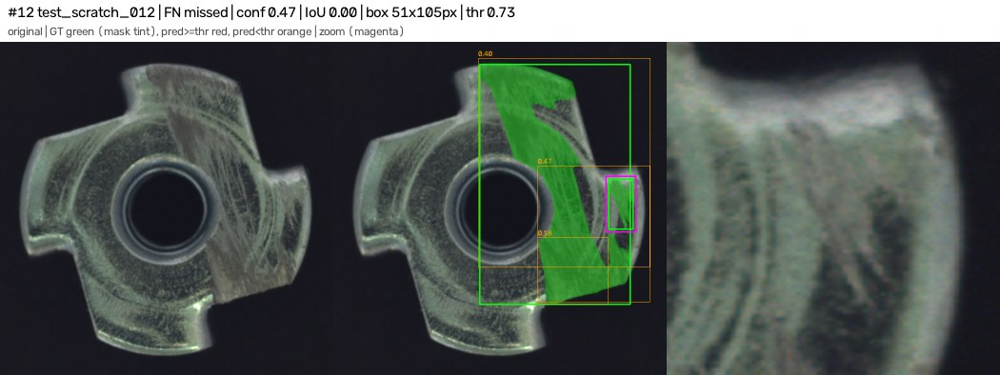 |
| 13 | test_scratch_013 | FN | below_threshold | scratch | 0.58 | 0.00 | 113×197 | 7.2 | 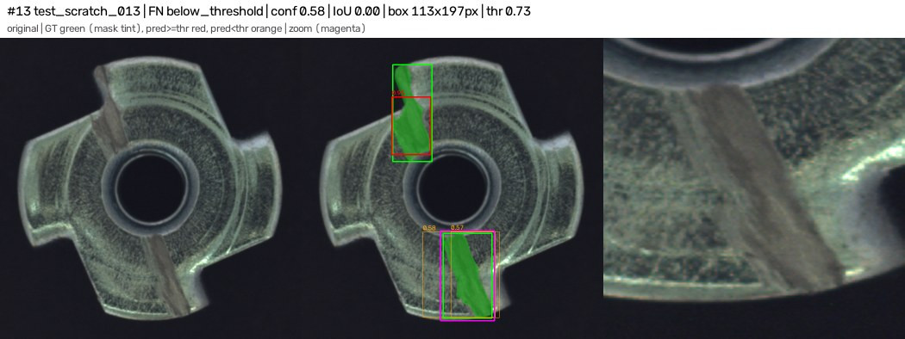 |
| 14 | test_scratch_020 | FN | below_threshold | scratch | 0.66 | 0.00 | 159×150 | 12.4 | 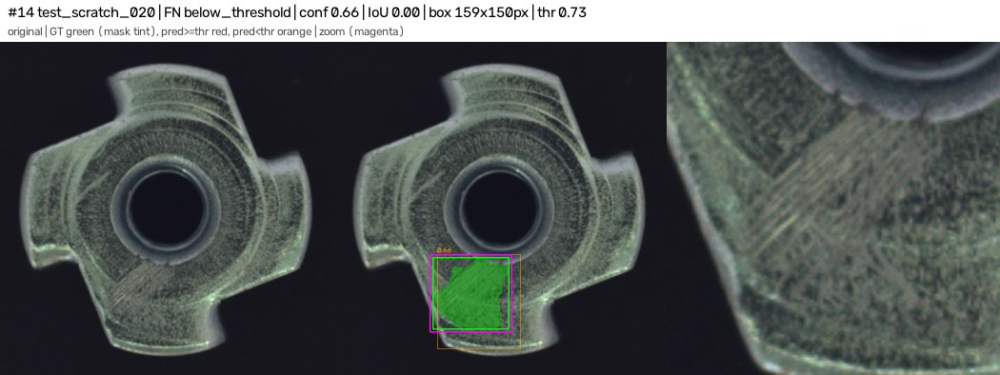 |

## Image-level errors

| image | type | max score |
|---|---|---|
| test_bent_010 | defective part PASSED (missed) | 0.553 |
| test_bent_019 | defective part PASSED (missed) | 0.697 |
| test_color_004 | defective part PASSED (missed) | 0.685 |
| test_scratch_000 | defective part PASSED (missed) | 0.332 |
| test_scratch_012 | defective part PASSED (missed) | 0.470 |
| test_scratch_020 | defective part PASSED (missed) | 0.665 |

## Threshold sensitivity (reported only; threshold was fixed on val)

| conf | box P | box R | defective flagged | normal flagged |
|---|---|---|---|---|
| 0.05 | 0.636 | 0.875 | 29/29 | 0/40 |
| 0.1 | 0.694 | 0.850 | 29/29 | 0/40 |
| 0.15 | 0.694 | 0.850 | 29/29 | 0/40 |
| 0.2 | 0.708 | 0.850 | 29/29 | 0/40 |
| 0.25 | 0.708 | 0.850 | 29/29 | 0/40 |
| 0.3 | 0.739 | 0.850 | 29/29 | 0/40 |
| 0.35 | 0.750 | 0.825 | 28/29 | 0/40 |
| 0.4 | 0.805 | 0.825 | 28/29 | 0/40 |
| 0.45 | 0.821 | 0.800 | 28/29 | 0/40 |
| 0.5 | 0.865 | 0.800 | 27/29 | 0/40 |
| 0.55 | 0.914 | 0.800 | 27/29 | 0/40 |
| 0.6 | 0.968 | 0.750 | 26/29 | 0/40 |
| 0.65 | 0.968 | 0.750 | 26/29 | 0/40 |
| 0.7 | 1.000 | 0.650 | 23/29 | 0/40 |
| 0.75 | 1.000 | 0.625 | 23/29 | 0/40 |
| 0.8 | 1.000 | 0.575 | 21/29 | 0/40 |
| 0.85 | 1.000 | 0.425 | 16/29 | 0/40 |
| 0.9 | 1.000 | 0.350 | 13/29 | 0/40 |
| 0.95 | 1.000 | 0.200 | 8/29 | 0/40 |
