# Failure gallery — baseline_zfr on test (conf ≥ 0.11, IoU 0.5)

Auto-generated from saved predictions. Colours: green = ground truth (mask tinted), red = prediction ≥ threshold, orange = prediction below threshold (≥ 0.05), magenta = the box this case is about.

Total box-level errors: **21** — FN/below_threshold: 2, FN/fragmentation_or_merged: 3, FN/missed: 1, FP/duplicate: 6, FP/fragmentation_or_merged: 6, FP/localisation: 1, FP/spurious_on_defective: 2
Image-level errors: **0**

| # | image | kind | error type | category | conf | IoU | box (px) | contrast | panel |
|---|---|---|---|---|---|---|---|---|---|
| 0 | test_bent_005 | FN | below_threshold | bent | 0.09 | 0.00 | 101×54 | 13.3 | 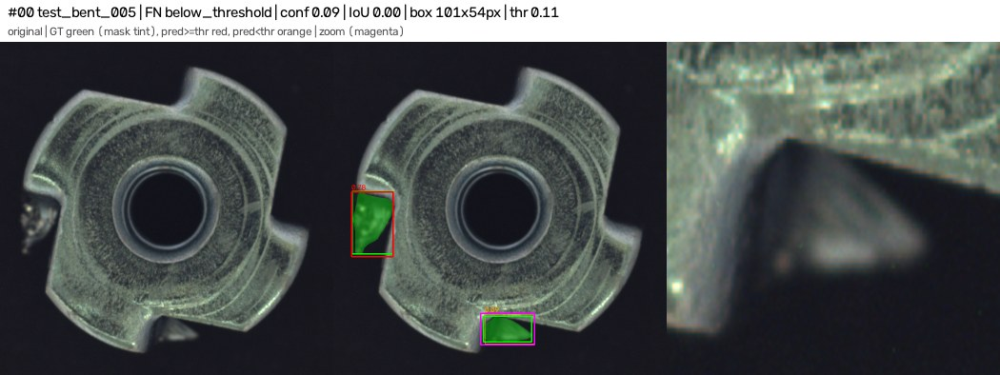 |
| 1 | test_bent_010 | FN | fragmentation_or_merged | bent | 0.55 | 0.12 | 38×94 | 1.5 | 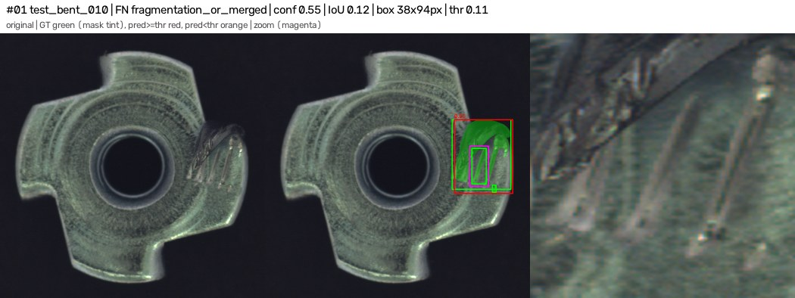 |
| 2 | test_bent_010 | FN | fragmentation_or_merged | bent | 0.55 | 0.01 | 11×19 | 12.1 | 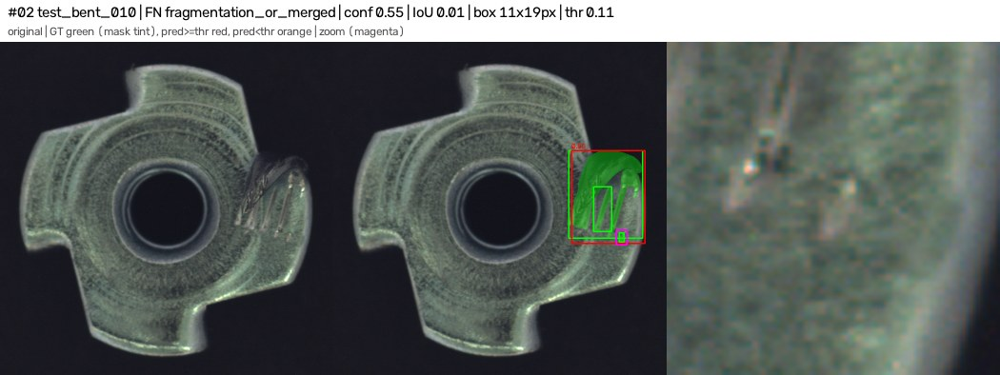 |
| 3 | test_bent_012 | FN | below_threshold | bent | 0.00 | 0.02 | 27×52 | 6.2 | 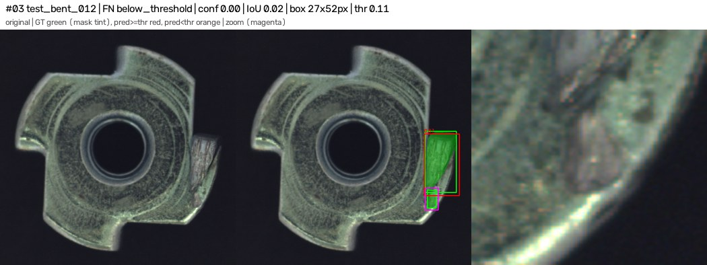 |
| 4 | test_bent_019 | FP | duplicate | bent | 0.58 | 0.67 | 117×281 | 9.0 | 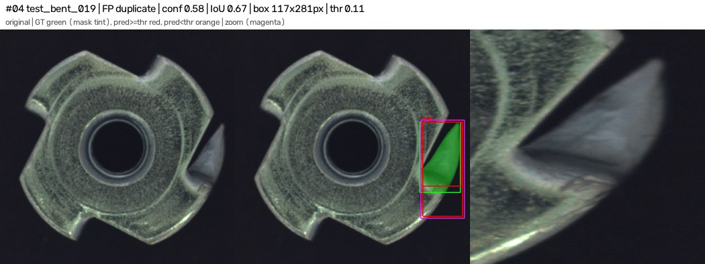 |
| 5 | test_color_004 | FP | fragmentation_or_merged | color | 0.27 | 0.16 | 49×37 | 4.6 | 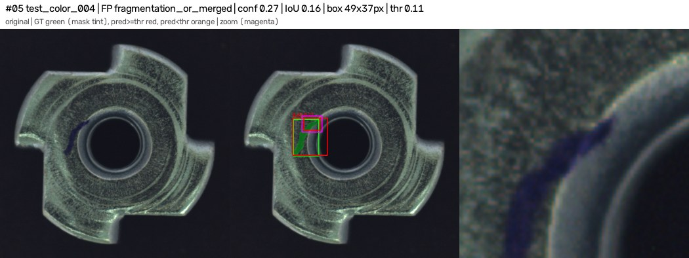 |
| 6 | test_color_007 | FN | missed | color | 0.91 | 0.01 | 10×12 | 3.7 | 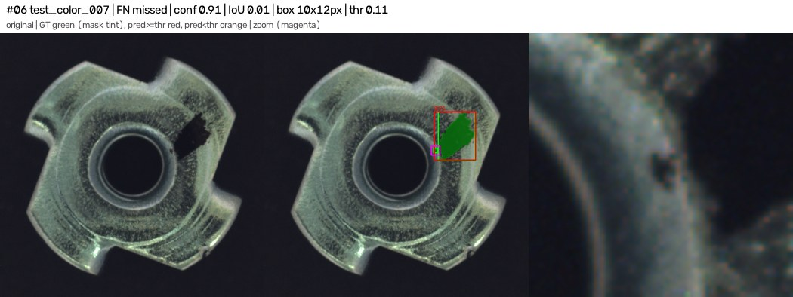 |
| 7 | test_color_011 | FP | duplicate | color | 0.50 | 0.63 | 183×225 | 11.7 | 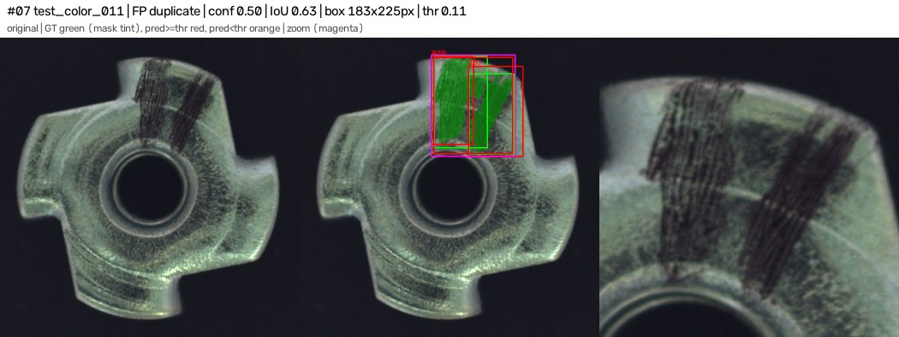 |
| 8 | test_color_014 | FP | localisation | color | 0.47 | 0.41 | 159×198 | 26.1 | 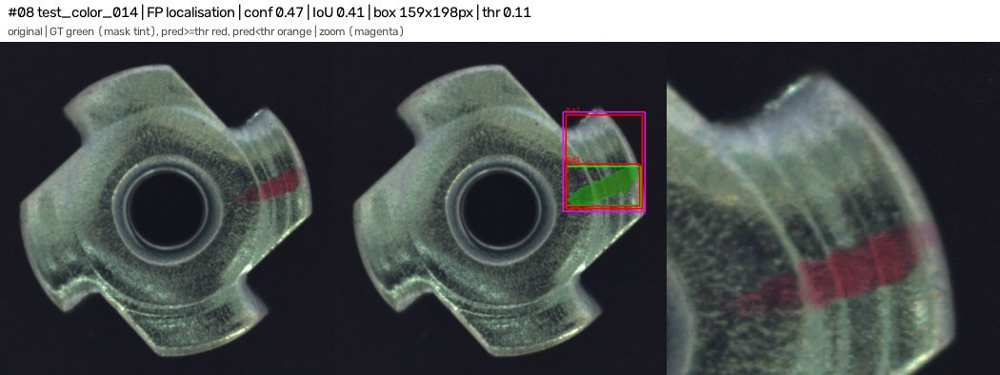 |
| 9 | test_color_015 | FP | duplicate | color | 0.44 | 0.52 | 405×269 | 1.3 | 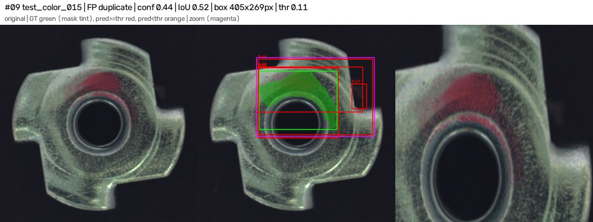 |
| 10 | test_color_015 | FP | duplicate | color | 0.40 | 0.52 | 369×160 | 9.0 | 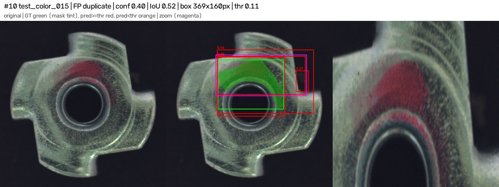 |
| 11 | test_color_015 | FP | spurious_on_defective | color | 0.29 | 0.00 | 52×87 | 37.9 | 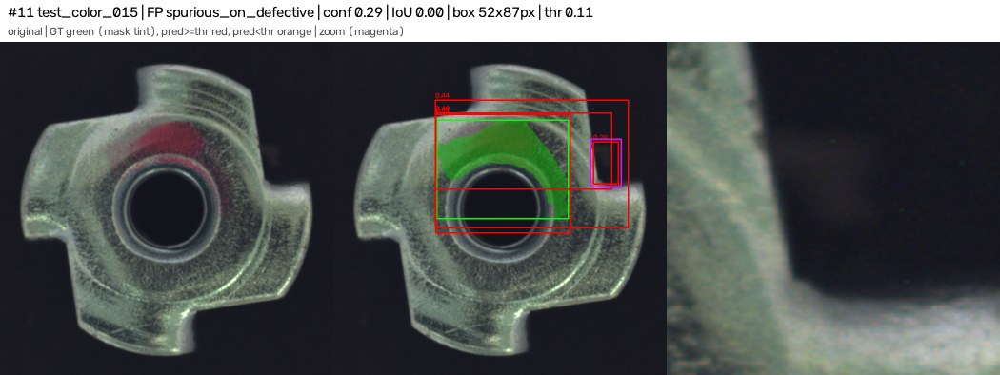 |
| 12 | test_color_017 | FP | fragmentation_or_merged | color | 0.31 | 0.01 | 13×13 | 41.4 | 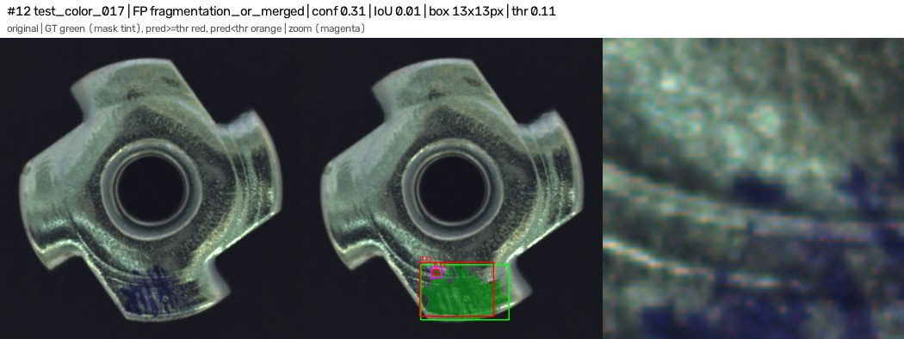 |
| 13 | test_color_019 | FP | duplicate | color | 0.53 | 0.57 | 88×227 | 15.2 | 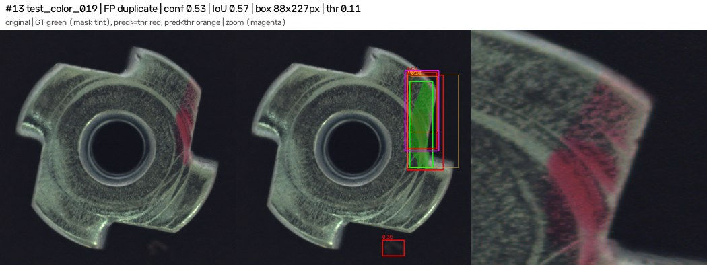 |
| 14 | test_color_019 | FP | spurious_on_defective | color | 0.38 | 0.00 | 65×46 | 4.5 | 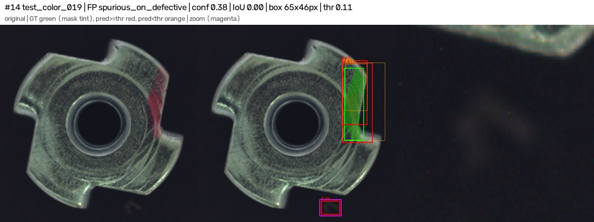 |
| 15 | test_scratch_009 | FP | fragmentation_or_merged | scratch | 0.65 | 0.05 | 60×47 | 7.1 | 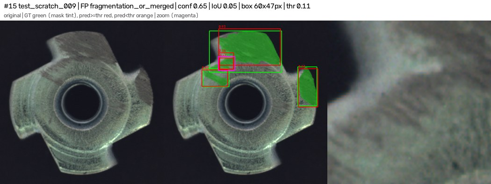 |
| 16 | test_scratch_009 | FP | fragmentation_or_merged | scratch | 0.36 | 0.08 | 63×70 | 10.1 | 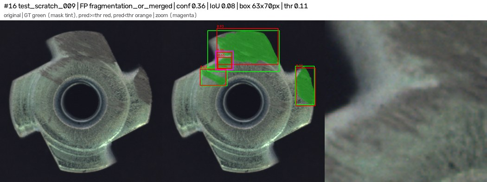 |
| 17 | test_scratch_012 | FN | fragmentation_or_merged | scratch | 0.47 | 0.08 | 51×105 | 5.0 | 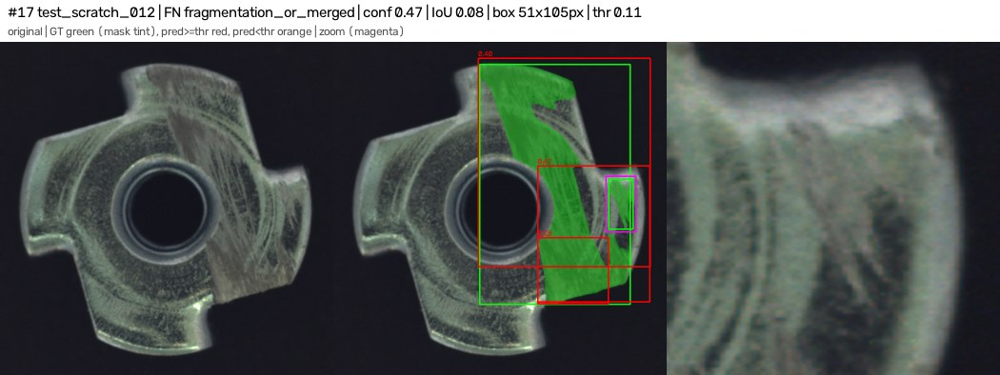 |
| 18 | test_scratch_012 | FP | fragmentation_or_merged | scratch | 0.47 | 0.32 | 236×286 | 33.2 | 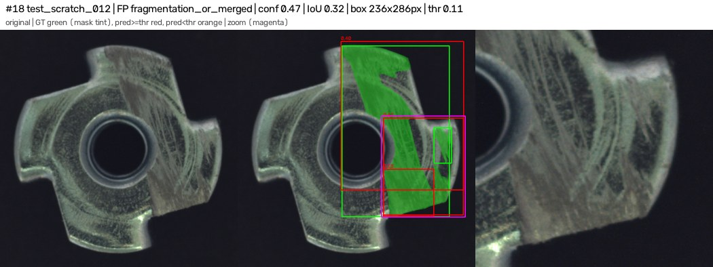 |
| 19 | test_scratch_012 | FP | fragmentation_or_merged | scratch | 0.18 | 0.13 | 147×139 | 11.4 | 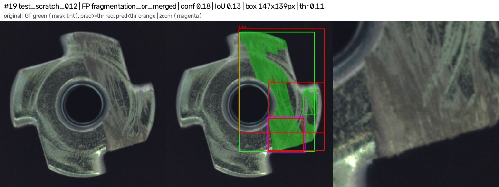 |
| 20 | test_scratch_013 | FP | duplicate | scratch | 0.57 | 0.72 | 112×200 | 17.0 | 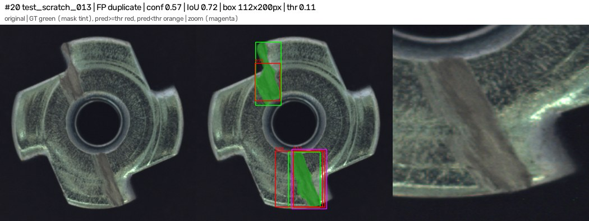 |

## Image-level errors

| image | type | max score |
|---|---|---|

## Threshold sensitivity (reported only; threshold was fixed on val)

| conf | box P | box R | defective flagged | normal flagged |
|---|---|---|---|---|
| 0.05 | 0.636 | 0.875 | 29/29 | 0/40 |
| 0.1 | 0.694 | 0.850 | 29/29 | 0/40 |
| 0.15 | 0.694 | 0.850 | 29/29 | 0/40 |
| 0.2 | 0.708 | 0.850 | 29/29 | 0/40 |
| 0.25 | 0.708 | 0.850 | 29/29 | 0/40 |
| 0.3 | 0.739 | 0.850 | 29/29 | 0/40 |
| 0.35 | 0.750 | 0.825 | 28/29 | 0/40 |
| 0.4 | 0.805 | 0.825 | 28/29 | 0/40 |
| 0.45 | 0.821 | 0.800 | 28/29 | 0/40 |
| 0.5 | 0.865 | 0.800 | 27/29 | 0/40 |
| 0.55 | 0.914 | 0.800 | 27/29 | 0/40 |
| 0.6 | 0.968 | 0.750 | 26/29 | 0/40 |
| 0.65 | 0.968 | 0.750 | 26/29 | 0/40 |
| 0.7 | 1.000 | 0.650 | 23/29 | 0/40 |
| 0.75 | 1.000 | 0.625 | 23/29 | 0/40 |
| 0.8 | 1.000 | 0.575 | 21/29 | 0/40 |
| 0.85 | 1.000 | 0.425 | 16/29 | 0/40 |
| 0.9 | 1.000 | 0.350 | 13/29 | 0/40 |
| 0.95 | 1.000 | 0.200 | 8/29 | 0/40 |
