# Failure gallery — improvement_zfr on test (conf ≥ 0.05, IoU 0.5)

Auto-generated from saved predictions. Colours: green = ground truth (mask tinted), red = prediction ≥ threshold, orange = prediction below threshold (≥ 0.05), magenta = the box this case is about.

Total box-level errors: **19** — FN/below_threshold: 1, FN/fragmentation_or_merged: 3, FN/localisation: 1, FN/missed: 3, FP/duplicate: 8, FP/fragmentation_or_merged: 2, FP/localisation: 1
Image-level errors: **1**

| # | image | kind | error type | category | conf | IoU | box (px) | contrast | panel |
|---|---|---|---|---|---|---|---|---|---|
| 0 | test_bent_010 | FN | fragmentation_or_merged | bent | 0.84 | 0.12 | 38×94 | 1.5 | 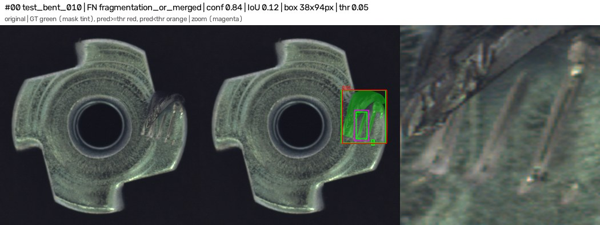 |
| 1 | test_bent_010 | FN | missed | bent | 0.84 | 0.00 | 11×19 | 12.1 | 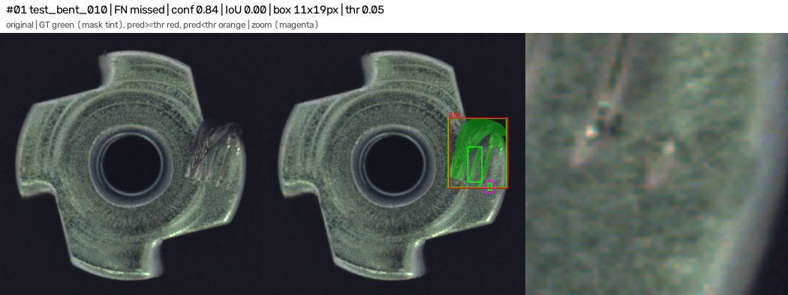 |
| 2 | test_bent_012 | FN | fragmentation_or_merged | bent | 0.06 | 0.48 | 27×52 | 6.2 | 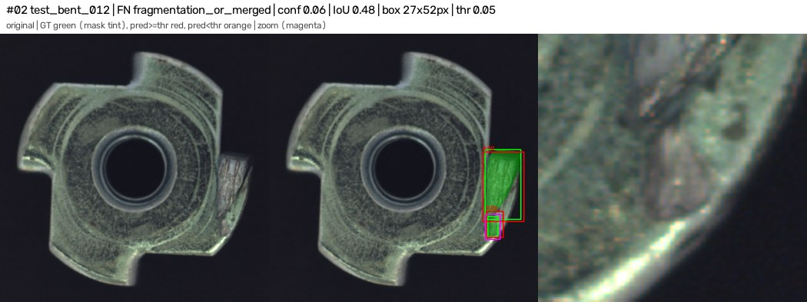 |
| 3 | test_bent_012 | FP | localisation | bent | 0.06 | 0.48 | 43×68 | 17.4 | 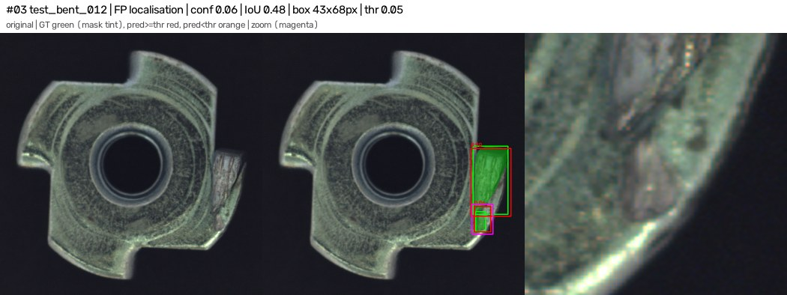 |
| 4 | test_bent_018 | FP | duplicate | bent | 0.06 | 0.71 | 50×39 | 15.6 | 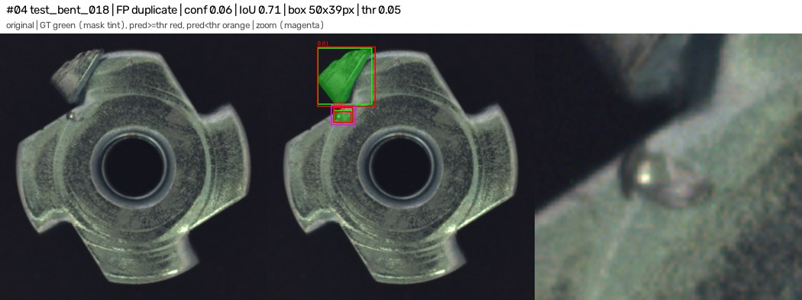 |
| 5 | test_bent_019 | FP | duplicate | bent | 0.16 | 0.55 | 100×139 | 7.8 | 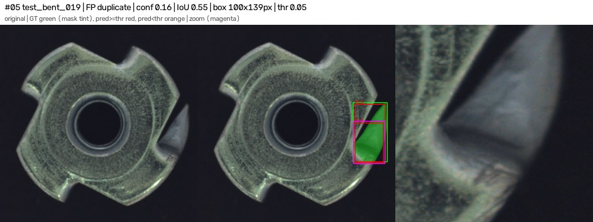 |
| 6 | test_color_004 | FN | missed | color | 0.00 | 0.00 | 77×112 | 8.9 | 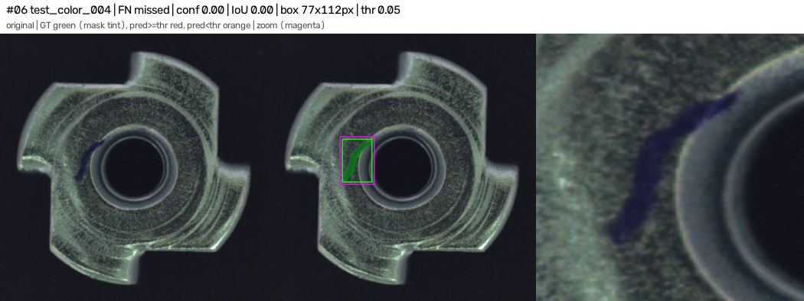 |
| 7 | test_color_007 | FN | fragmentation_or_merged | color | 0.77 | 0.01 | 10×12 | 3.7 | 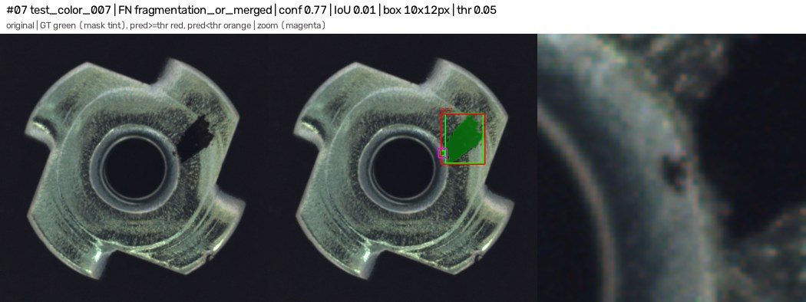 |
| 8 | test_color_011 | FN | below_threshold | color | 0.01 | 0.48 | 105×188 | 29.2 | 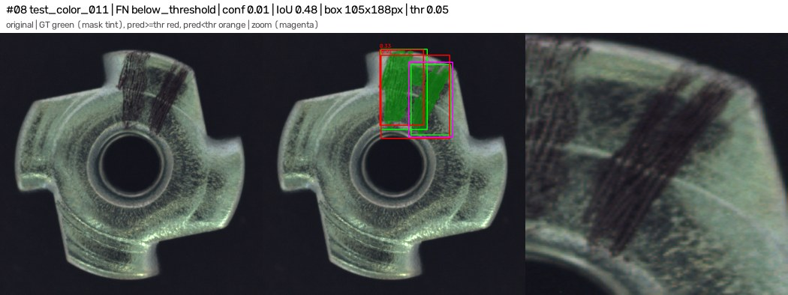 |
| 9 | test_color_011 | FP | duplicate | color | 0.33 | 0.85 | 116×202 | 3.9 | 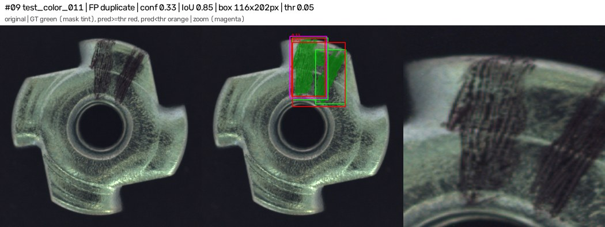 |
| 10 | test_color_014 | FP | duplicate | color | 0.13 | 0.56 | 150×141 | 2.8 | 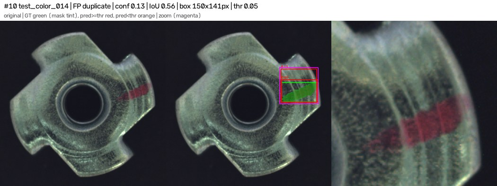 |
| 11 | test_color_015 | FP | duplicate | color | 0.45 | 0.71 | 287×278 | 22.9 | 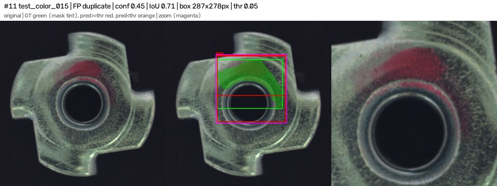 |
| 12 | test_color_019 | FP | duplicate | color | 0.06 | 0.59 | 83×202 | 16.2 | 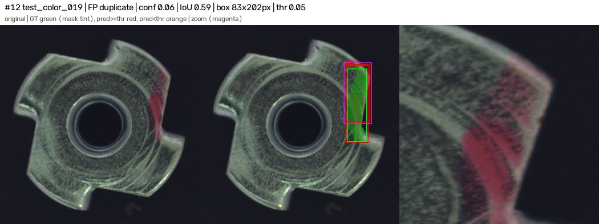 |
| 13 | test_scratch_012 | FN | localisation | scratch | 0.18 | 0.43 | 316×504 | 12.0 | 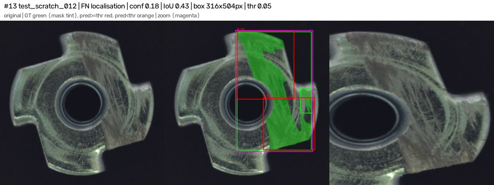 |
| 14 | test_scratch_012 | FN | missed | scratch | 0.47 | 0.07 | 51×105 | 5.0 | 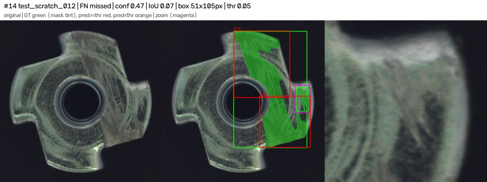 |
| 15 | test_scratch_012 | FP | fragmentation_or_merged | scratch | 0.47 | 0.28 | 219×221 | 16.5 | 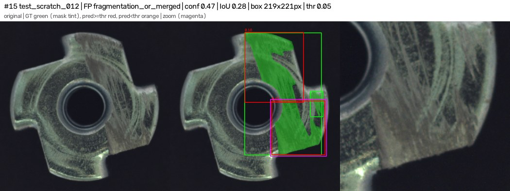 |
| 16 | test_scratch_012 | FP | fragmentation_or_merged | scratch | 0.18 | 0.43 | 241×289 | 23.2 | 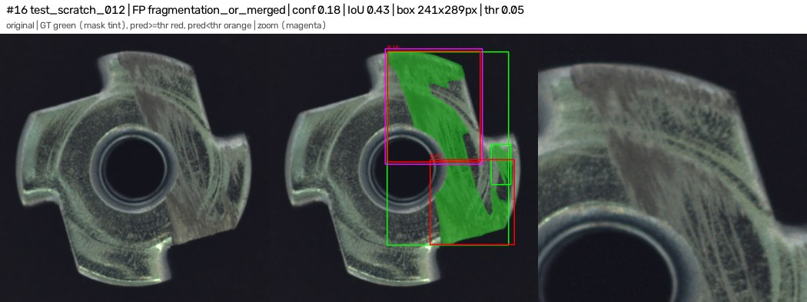 |
| 17 | test_scratch_014 | FP | duplicate | scratch | 0.59 | 0.68 | 423×178 | 20.2 | 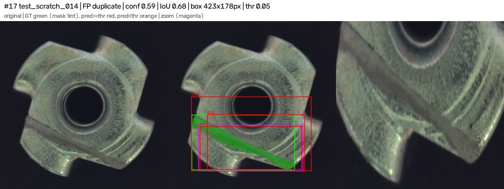 |
| 18 | test_scratch_014 | FP | duplicate | scratch | 0.26 | 0.76 | 405×235 | 21.6 | 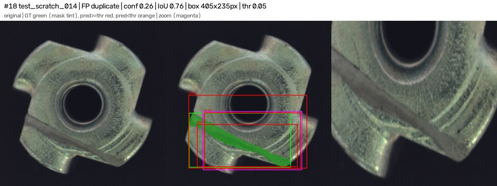 |

## Image-level errors

| image | type | max score |
|---|---|---|
| test_color_004 | defective part PASSED (missed) | 0.001 |

## Threshold sensitivity (reported only; threshold was fixed on val)

| conf | box P | box R | defective flagged | normal flagged |
|---|---|---|---|---|
| 0.05 | 0.744 | 0.800 | 28/29 | 0/40 |
| 0.1 | 0.800 | 0.800 | 28/29 | 0/40 |
| 0.15 | 0.816 | 0.775 | 27/29 | 0/40 |
| 0.2 | 0.861 | 0.775 | 27/29 | 0/40 |
| 0.25 | 0.857 | 0.750 | 27/29 | 0/40 |
| 0.3 | 0.882 | 0.750 | 27/29 | 0/40 |
| 0.35 | 0.909 | 0.750 | 27/29 | 0/40 |
| 0.4 | 0.903 | 0.700 | 26/29 | 0/40 |
| 0.45 | 0.933 | 0.700 | 26/29 | 0/40 |
| 0.5 | 0.964 | 0.675 | 24/29 | 0/40 |
| 0.55 | 0.964 | 0.675 | 24/29 | 0/40 |
| 0.6 | 1.000 | 0.675 | 24/29 | 0/40 |
| 0.65 | 1.000 | 0.625 | 23/29 | 0/40 |
| 0.7 | 1.000 | 0.550 | 20/29 | 0/40 |
| 0.75 | 1.000 | 0.550 | 20/29 | 0/40 |
| 0.8 | 1.000 | 0.300 | 10/29 | 0/40 |
| 0.85 | 1.000 | 0.225 | 8/29 | 0/40 |
| 0.9 | 1.000 | 0.150 | 6/29 | 0/40 |
| 0.95 | nan | 0.000 | 0/29 | 0/40 |
